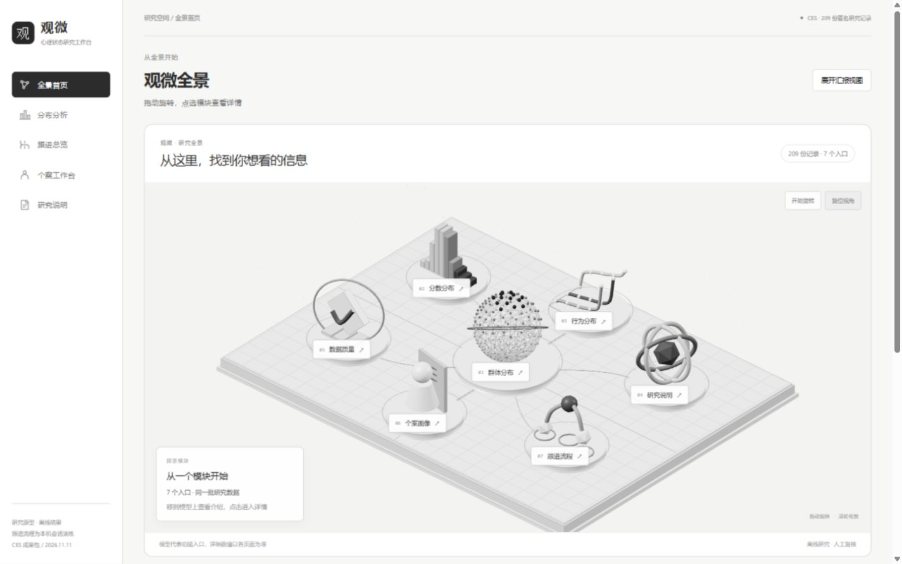
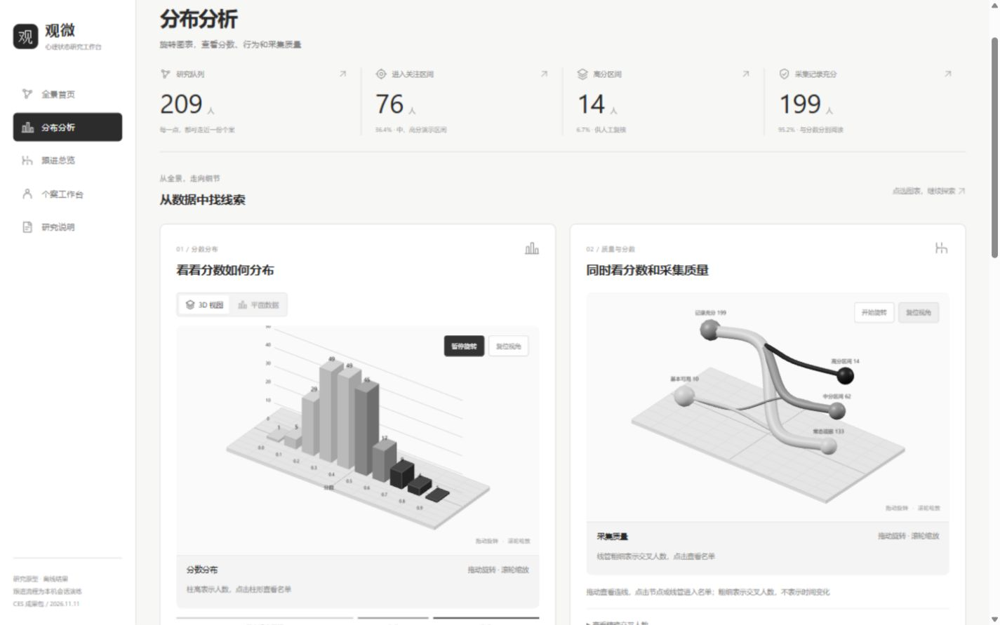

# 观微工作台 · 3D 全景版

基于既有心理状态研究结果制作的本地交互预览，用一个可旋转的 3D 展台连接群体分布、个案画像和跟进流程。

当前版本：**2026-11-16 · 3D 全景版**



## 快速体验

下载仓库中的 [离线 ZIP 包](观微工作台_3D全景版_2026-11-16.zip)，完整解压后，使用 Edge、Chrome 等现代浏览器打开“打开工作台.html”。

页面、3D 运行库、图标和展示数据均已内置，运行时无需联网或安装依赖。3D 场景需要浏览器支持 WebGL 2。

如需从源码运行，先安装 Node.js 18 或更新版本，再执行：

```bash
cd workbench-preview
node serve.mjs
```

打开终端显示的 [本地预览地址](http://127.0.0.1:4173/)。端口被占用时，可以运行 `node serve.mjs 4174`。

## 首页操作

- 首页提供群体分布、分数分布、行为分布、数据质量、个案画像、跟进流程和研究说明 7 个入口
- 鼠标移到模型或标签上时，显示介绍并抬起模型；移开后复位，点击进入详情
- 拖动模型可转动单个模型，拖动空白可转动整个展台，滚轮可缩放
- 模型缓慢旋转并轻微浮动，配有低密度粒子；可暂停动态或复位视角
- 拖动超过 6 像素后不会触发点击跳转
- 支持键盘操作和系统“减少动态效果”设置

## 页面与图表

| 页面 | 主要内容 |
| --- | --- |
| 全景首页 | 整体 3D 展台、7 种模块造型、直接入口与核心人数 |
| 分布分析 | 可旋转的 3D 分数柱形、行为点云、质量关系图，以及精确交叉人数 |
| 跟进总览 | 关注名单、3D 阶段装置、优先记录和会话动态 |
| 个案工作台 | 匿名编号检索、条件筛选、3D 行为偏离、质量说明、跟进演练与模板摘要 |
| 研究说明 | 3D 模型结果圆环、精确指标表、数据来源和解释范围 |



## 数据与演示范围

本预览包含 **209 份匿名展示记录**：高分区间 14 份、中分区间 62 份、常态观察 133 份；采集记录充分 199 份、基本可用 10 份。

记录使用匿名编号，展示数据不包含姓名、学号、完整参与者标识或个人研究标签。分数统计使用同轮未舍入的折外预测结果，页面显示保留三位小数。

- 0.50 / 0.70 是演示切分阈值，区间不等于临床诊断
- 首页模型是功能入口，其造型和位置不表示地理位置、社交关系或心理原因
- 行为图与质量关系图描述已有数据，不表示因果或个人历史变化
- 跟进阶段和备注仅在本次页面会话内保存，刷新后清空，不表示真实访谈或干预
- 摘要由固定模板生成，当前版本没有重新训练模型，也没有接入实时校园业务

仓库仅包含当前预览及其离线交付包，研究原始资料、论文、训练成果和旧版本交付包不在本次提交范围内。

## 源码结构

```text
workbench-preview/
├── index.html            页面骨架
├── ui.css                界面与响应式样式
├── scene3d.js            统一 3D 场景、建模、动画和交互
├── visuals.js            模块入口、图表组件、图标和数值
├── app.js                导航、筛选、个案、跟进和摘要
├── data.js               匿名展示数据与已保存实验指标
├── three-runtime.js      已打包的 3D 运行库
├── THREE-LICENSE.txt     第三方许可证
├── serve.mjs             本地预览服务
├── build-offline.mjs     离线交付包生成脚本
├── 预览说明.md           详细操作和数据口径
└── screenshots/          当前版本效果截图
```

需要重新生成离线交付目录时，在 `workbench-preview` 中运行 `node build-offline.mjs`。输出位于仓库根目录的“交付包”文件夹。

## 验证记录

当前版本已进行 JavaScript 语法、数据与人数一致性检查，并通过浏览器验证模块跳转、整体与单模型拖动、3D 柱形下钻、质量筛选、行为选择、跟进和摘要。

检查了 320、390、1024、1440 像素宽度，整页无横向溢出。独立单文件通过本机 HTTP 验收；自动浏览器工具限制 `file:` 协议，因此双击入口未自动验收。

## 第三方组件

3D 运行库使用 **Three.js 0.180.0**，依据 MIT 许可证提供。完整许可见 [THREE-LICENSE.txt](workbench-preview/THREE-LICENSE.txt)。该许可说明针对第三方运行库，不代表仓库其他内容自动适用同一许可。
