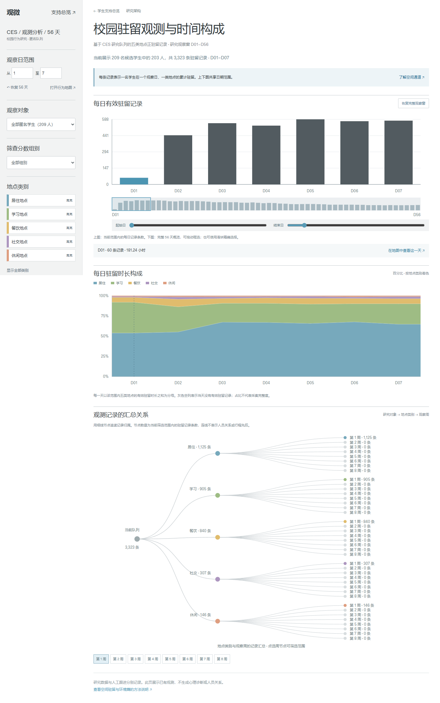

# 观微工作台

观微是一个面向校园行为研究的本地交互预览。当前版本将多通道研究架构、匿名驻留记录与学生观测分析放在同一个界面中，供研究展示和人工核对。

> 本项目为研究与演示原型，不是临床诊断工具，也没有接入实时校园业务。分数和行为记录不能单独作为对学生采取行动的依据。

## 快速体验

**推荐下载 [校园行为工作台离线包](观微工作台_离线版_20261119.zip)**，完整解压后，用 Edge 或 Chrome 打开文件夹中的 `index.html`。页面、匿名展示数据与字体均已包含在包中，无需联网或安装依赖。

也可以下载完整仓库，直接打开 [campus-atlas/index.html](campus-atlas/index.html)。请保留 `campus-atlas` 内的目录结构，不要只复制 HTML 文件。移动端图表可在图表区域左右滑动。

## 当前界面

| 页面 | 可以做什么 |
| --- | --- |
| 研究架构首页 | 查看行为与节律、空间驻留与环境熵、行为隐因子三个通道；从地点进入地图 |
| 学生支持总览 | 查看队列覆盖与分数组别；浏览匿名学生名单；从示例学生进入观测分析 |
| 观测分析 | 按学生、分数组别和观察日筛选；查看每日记录柱图、56 天概览、地点时长构成与按地点和观察周汇总的节点图 |
| 校园行为地图 | 按地点、分组、时长和观察日筛选驻留点；框选地图区域、播放日期、查看学生详情及导出当前范围记录 |
| 研究方法展开 | 查看三个通道、空间锚定自适应门控 (CA-Gate 2.0) 研判机制与验证结果；从学生详情进入时保留个案上下文 |



[学生支持总览预览](campus-atlas/screenshots/overview-1440.png) · [研究方法展开预览](campus-atlas/screenshots/research-spatial-1440.png)

## 研究数据与解释范围

- 展示数据包括 **209 名匿名学生**；其中 **206 人**在前 56 个相对观察日内有五类地点的有效正驻留记录，共 **23,341 条**。
- 每条驻留记录表示一名学生在一个观察日、一类地点的累计驻留时长。地点类别为居住、学习、餐饮、社交和休闲；点的位置用于展示，不是实际地理坐标或移动轨迹。
- **14 人**达到 0.70 的高分展示阈值，其中 13 人有可绘制驻留记录。分数基于空间锚定自适应门控 (CA-Gate 2.0) 的严密折外交叉验证预测，阈值仅作筛查分层参考，不等于临床诊断。
- 观测分析中的地点时长占比，以当前筛选人群当天五类有效驻留时长之和为分母。无有效记录不等同于驻留 0 小时；节点图表达记录汇总关系，不表示人员关系或行程顺序。
- 严密分层 5 折 × 10 次重复（共 50 折独立验证）基准：原始 25 全特征基线 ROC-AUC 0.521 ± 0.080、老版直接拼接加权 0.540 ± 0.076、空间单通道 0.632 ± 0.079；采用空间锚定自适应门控 (CA-Gate 2.0) 后，AUC 提升至 0.618~0.631 ± 0.078（相对老版提升 +14.4%），Macro-F1 达到 0.572 ± 0.068（超越空间单通道 0.571），危机召回率达 64.2%，有效解决了多模态弱特征稀释空间主干的问题。
- 该研究使用前 56 天的行为观测，预测后 56 天内是否曾出现 PHQ-4 总分 ≥ 6。界面不能据此推断个人心理状态或行为原因。

## 当前进度

当前版本已实现研究架构、学生支持总览、观测分析、校园行为地图和研究方法展开。复核单、支持计划、回访日程和工作简报尚未实现；总览中的学生卡片是观测示例，不代表真实跟进记录。

[企业合作首演需求与 UI 交接](企业合作首演_需求与UI交接.md) 是历史规划文档，其中的页面和验收目标不等于当前实现状态。

## 文件结构

```text
campus-atlas/
├── index.html            页面入口
├── atlas.css / atlas.js  原首页、地图筛选与页面路由
├── diagram.js            研究架构图
├── pointmap.js           驻留点绘制与交互
├── dataset.js            匿名展示数据
├── observations.css / observations.js  观测分析
├── workbench.css / workbench.js        学生支持总览与研究方法
├── fonts/                本地字体
└── screenshots/          当前界面预览
```

`tools/export_atlas.py` 是展示数据导出脚本；运行它可能依赖仓库未包含的原始研究资料。`workbench-preview/` 和 [2026-11-16 3D 离线包](观微工作台_3D全景版_2026-11-16.zip) 是之前的预览资料，与上述校园行为工作台为不同版本；旧版说明保留在 [workbench-preview/预览说明.md](workbench-preview/预览说明.md)。

## 验证与第三方资源

2026-11-19 在本机 Chrome 中验证了新版离线包：完整解压后可打开，名单、日期框选、观测图与地图跳转通过检查；320、390、768、1024、1440 像素宽度下整页未出现横向溢出。未在另一台实体电脑上验证，浏览器和屏幕可能带来视觉差异。

旧版 3D 预览使用 Three.js，许可见 [THREE-LICENSE.txt](workbench-preview/THREE-LICENSE.txt)。仓库包含本地字体；字体及其他第三方资源的授权范围尚未在本说明中核实，重新分发前请确认相应权利。
